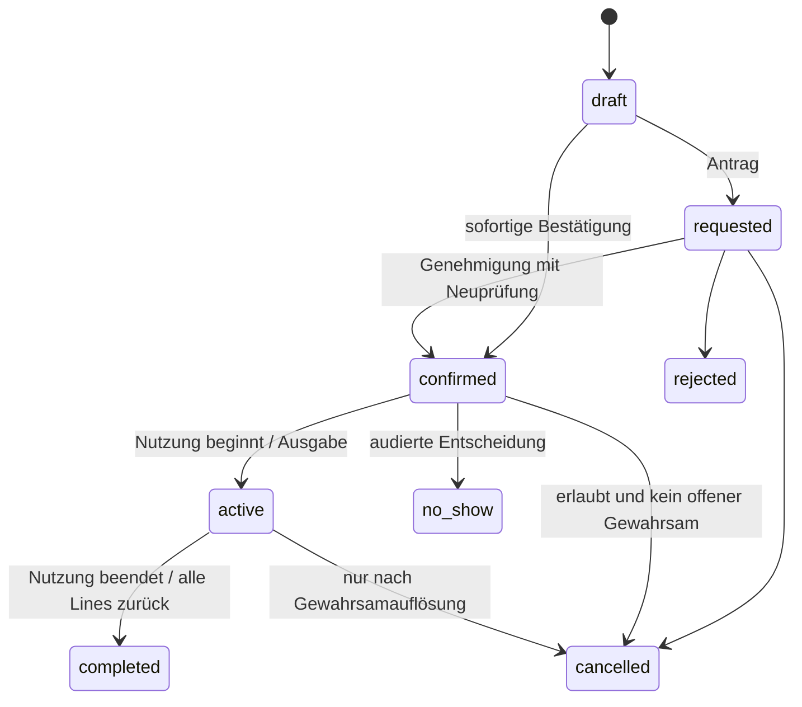

# Buchungsengine

## Eine Schreibgrenze

Alle Bestätigungen, Änderungen, Genehmigungen, Ausgaben, Rücknahmen, Sperren und Erweiterungen verwenden denselben Allocation-Service. Vorschau ist unverbindlich; ausschließlich der erfolgreiche Commit bestätigt. Jede Operation prüft Actor und Beneficiary getrennt, aktive Konten, Grants, Einweisungen, Vereinbarungen und Zeiten.

## Zeit und Termine

UTC-Instants in PostgreSQL, IANA-Zeitzone am Zeitplan und Serie; Europe/Berlin als konfigurierbarer Startwert. Intervalle sind `[start,end)`; belegte Bereiche enthalten Setup-/Cleanup-Puffer. Benachbarte Buchungen ohne Puffer sind zulässig.

Tagesausleihe: angezeigte Start- und letzte Ausleihtage inklusiv; intern zusätzlich lokales exklusives Enddatum Folgetag speichern. Tagesanzahl aus lokalen dates, niemals Sekunden/86400. Konkrete Abhol-/Rückgabetermine und daraus abgeleiteter Belegungsbereich separat. Rückgabe nach Tagesgrenze erweitert die Belegung bis tatsächlichem Termin. Abholung vor Beginn ebenso. Keine automatische Terminverschiebung bei Feiertagen; gültige Alternativen anbieten und bestätigen lassen.

Nicht existierende Uhrzeit beim Frühlingswechsel ablehnen, keine stille Verschiebung. Bei doppelter Herbstzeit muss eine konkrete Instanz/UTC-Offset ausgewählt werden. Serien mit ungültigen oder mehrdeutigen Vorkommen brauchen explizite Korrektur/Ausnahme vor Genehmigung. Jede Occurrence wird aus lokaler Uhrzeit erzeugt, niemals durch Addition von 7*24 UTC-Stunden.

Öffnung, Abholung, Rückgabe, Nutzung sind unterschiedliche Zeitpläne. Website bleibt jederzeit nutzbar. Nutzungszeit = Resource-Fenster geschnitten mit Gebäudezugang; betreute Öffnung zusätzlich erforderlich, außer anwendbares Gruppengrant erlaubt unbetreute Nutzung. Harte Schließung/Wartung gewinnt immer. Abhol-/Rückgabefenster werden durch unbetreute Nutzungsrechte nicht erweitert.

## Zustandsmaschinen

Abgelehnte/stornierte/no-show/completed Buchungen sind terminal; Korrektur durch verknüpften neuen Vorgang. Bearbeitungen erhalten Revision und Ereignis. Raum-Active/Completed kann zeitgesteuert erfolgen; physische Ausleihe nie automatisch als zurückgegeben. Serien haben requested/approved/rejected/cancelled, Occurrences eigene Zustände.

Loan wird erst bei Ausgabe angelegt: checked_out → partially_returned → returned. Ausgabevorbereitung ist eine Booking-Projektion (reserviert/abholbereit), kein fingierter Gewahrsam. overdue wird je offener Line aus due_at berechnet; lost/damaged sind Zustands-/Vorfallflags. Verlust schließt Gewahrsam nur durch ausdrückliche audierte Auflösung und Asset-Sperre; keine Wiederfreigabe eines verlorenen Gegenstands.

## PostgreSQL-Strategie

Gemeinsame AllocationClaim-Tabelle schützt Reservierung, temporären Hold und Wartung vor überlappenden exklusiven Zusagen. Aktive Claims haben `tstzrange` mit `[)` und GiST-Exclusion `(unit_id WITH =, during WITH &&)`; btree_gist für UUID-Gleichheit. Check gegen leere Bereiche. Eigentümer-FKs und CHECK sichern genau eine Eigentümerart. DB schützt lokale Constraints; Services schützen modulübergreifende Regeln.

Transaktion bei READ COMMITTED:

1. Idempotenzdatensatz für actor+operation+key beanspruchen; gleicher Key/anderer Payload → Konflikt, gleicher Payload → früheres Ergebnis.
2. Policy-/Membership-/Account-Revisionen unter gemeinsamen Sperrregeln lesen. Konfigurationsschreiber verwenden dieselben Policy-Sperren; keine TOCTOU-Lücke bei paralleler Kontosperre/Grant-Änderung.
3. Betroffene Pool-/Bundlekonfiguration sperren, Kandidaten bestimmen. Units in stabiler UUID-Reihenfolge mit SELECT FOR UPDATE sperren. Bei Serien alle betroffenen Einheiten/Occurrenceintervalle in einem begrenzten Vorgang.
4. Rechte, Zeitpläne, aktuelle Einweisungen/Vereinbarungen und aktive Claims neu prüfen. Pool wählt konkrete freie Units, Bundle alle Pflichtkomponenten atomar.
5. Booking, Claims, Events, Outbox und Idempotenzresultat schreiben; Exclusion-Verletzung in Savepoint abfangen und als sicheren Konflikt melden. Ganze Serien-/Bundleoperation zurückrollen.
6. Commit. Deadlock/Serializationfehler begrenzt mit gleichem Idempotenzkey wiederholen; nach höchstens drei Versuchen kontrollierter Retry-Fehler. Keine Endlosschleife.

Pool-Mitgliedschaftsänderungen nehmen Poollock vor Unitlocks; keine Neuzuweisung ausgegebener Assets. Alternative konkrete Units bei Checkout nur nach atomarer Freigabe/Neubelegung und neuer Vereinbarungsprüfung.

## Gewahrsam ohne falsches Verfügbarkeitsversprechen

Ein unbefristeter custody-Claim würde mit bereits bestätigten späteren Reservierungen kollidieren. Deshalb zwei ausdrücklich getrennte Sicherheitsregeln:

- Zeitliche Reservierungen bleiben in AllocationClaim unter Exclusion. Eine partielle Unique-Constraint erlaubt maximal einen aktiven custody-Datensatz je Unit; custody gehört nicht zur zeitlichen Exclusion.
- Offener custody verhindert jede zweite tatsächliche Ausgabe. Eine neue verbindliche Folgereservierung ist zulässig, wenn expected_return vor ihrem Beginn liegt (einschließlich erforderlicher Puffer) und kein aktiver zeitlicher Claim überlappt. Die erwartete Rückgabe darf zukünftige Verfügbarkeit planen, beendet aber niemals Gewahrsam. Bei Überziehung bleiben bestätigte Folgebuchungen bestehen und werden gefährdet markiert; Personal löst per Pool-Neuzuordnung, Ersatz, Rückholung, Umbuchung oder Storno.

Custody wird atomar mit Ausgabe unter Unitlock eröffnet, bei tatsächlicher Rücknahme beendet. Expected-return muss bei Ausgabe vorliegen. Verlängerungen prüfen unter denselben Locks alle Folgebuchungen; keine stille Überlappung. Überfälligkeit beendet Gewahrsam nicht. Neue zeitlich zulässige Folgereservierungen werden ebenfalls sofort als gefährdet gekennzeichnet, wenn der vorherige Loan bereits überfällig ist; Personal muss den tatsächlichen Konflikt explizit lösen. Bestehende Folgebuchungen bleiben bestehen. Das PostgreSQL-Gate prüft parallele Folgereservierung, Ausgabe, Verlängerung und Rückgabe. Owner-Freigabe vom 14.10.2026, ADR-002.

## Wartung und bestehende Zusagen

Sperrsetzung nimmt Unitlock. Ohne Konflikt entsteht zeitlicher maintenance-Claim. Bei bestehender Reservierung: ResourceBlock mit betroffenen Bookings als incidents speichern und neue Bestätigungen serverseitig verbieten; nicht durch Exclusion-Zwang bestehende Zusagen löschen. Incidents benötigen sichtbare Bearbeitung. Eine materielle Sperre gilt sofort, auch wenn Personal die Folgebuchungen noch nicht umgeplant hat. Race-Test booking vs block ist Pflicht.

## Serien, Anträge und Grenzen

Anträge standardmäßig nicht blockierend, keine temporären Holds im MVP. UI benennt fehlende Reservierung. Serien: zunächst wöchentlich, Wochentage, count oder until; Initial konfigurierbarer Default 52 Vorkommen, zusätzlich anwendbarer Horizont; kein hart codiertes fachliches Maximum. Kein freies unbeschränktes RRULE. Editor braucht create/approve-Recht und prüft Beneficiary; Mitarbeitermerkmal genügt nicht. Alle Vorkommen gemeinsam validieren und bestätigen, sonst keines. Konfliktliste ohne fremde Namen. Einzeländerung behält original occurrence key. „Ab hier ändern“ durch audierten Seriensplit, zunächst späterer Ausbau.

## Verfügbarkeit und Limits

Ergebnis mit reason codes aus Spezifikation, aktuellen revisions und unverbindlichem Hinweis. Unauthorized Resources liefern weder Konfliktzeiten noch Existenzdetails. Maximal parallele Buchungen werden unter Beneficiary-/Limitlock geprüft, auch für unterschiedliche Units. Alle Zeitfenster, Puffer, Granularität, Horizon und Lead Time laufen über denselben Resolver. Kein Admin darf echte Exclusion-Konflikte überschreiben.

## Zusätzliche Ausleihgates

Registrierung benötigt nur E-Mail/Passwort. Vor verbindlicher Reservierung für physische Ausleihe vollständiges BorrowerProfile, verifizierte E-Mail, aktives Konto und aktuelle erforderliche AgreementAcceptances. Reine Raum-/Maschinenzeit ohne Loan erfordert keine Anschrift, außer expliziter ResourcePolicy. Vor Ausgabe zusätzlich IdentityCheck (erstmalig), gültige versionierte Haftpflicht-Selbsterklärung und erneut aufgelöste globale/Item-/Bundle-Vereinbarungen. Haftpflicht bleibt standardmäßig je Textversion gültig; künftige zeitliche Gültigkeit ist optional konfigurierbar. Personal darf Zustimmung nicht stellvertretend setzen; Benutzer bestätigt angemeldet auf eigenem Gerät oder geschütztem Kiosk mit eigener Session. Fehlende Zustimmung blockiert Ausgabe, bestehende Reservierung wird nicht still gelöscht.

Technische Grundlage: [PostgreSQL Range Types und Exclusion](https://www.postgresql.org/docs/17/rangetypes.html). Konkreter DDL-Prototyp und Tests erst in genehmigter Implementierungsphase.

## Scanner-/Kioskvorbereitung und transaktionaler Abschluss

Owner-Ergänzung vom 15.10.2026: [Scannerkonzept](docs/KIOSK_SCANNER.md), [ADR-011](docs/adr/011.md). Read-only Identifikation gehört außerhalb des Booking-/Loanservices. Scans allein erzeugen weder Claims noch Gewahrsam. Erst bewusster Commit des vorbereiteten Korbs verwendet dieselben Actor-/Beneficiary-, Profil-, Agreement-, Haftpflicht-, Ausweis-, Qualification-, Zeit-/Policy- und Belegungsprüfungen wie andere Oberflächen.

Abholung bewahrt die vorhandene bestätigte Buchung; passende Reservierung anhand Beneficiary, Zeitraum und konkreter/Pool-Unit bestimmen, Mehrdeutigkeit ausdrücklich auflösen. Spontanausleihe ist ein verbindlicher späterer Loan-Workflow ohne vorherige Onlinebuchung: für registrierten Beneficiary Booking/Allocation und Loan gemeinsam transaktional erzeugen. Mehrere Bookings dürfen in einer Ausgabe über LoanBooking/LoanLines zusammengefasst werden, jeweils mit unverlorenem ursprünglichem Allocationbezug.

Alle erforderlichen Positionen atomar bestätigen, konsistente Unitlock-Reihenfolge und Idempotenz des Gesamtkorbs; im Konflikt keine heimliche Teilreservierung/-ausgabe. Wiederholte Aliasscans desselben Assets deduplizieren. Aktuelle Alias-/Asset-/Unitzuordnung und Rechte direkt vor Abschluss revalidieren. Scanner-Rücknahme schließt ausdrücklich ausgewählte LoanLines, nicht allein aufgrund des Scans den ganzen Loan. Kontosperre des Borrowers verhindert keine autorisierte Rücknahme. Keine Offline-Writes oder automatische Replay-Ausgabe nach Reconnect. Die Owner-Regeln für Folgereservierungen bei offenem Gewahrsam gelten unverändert.
