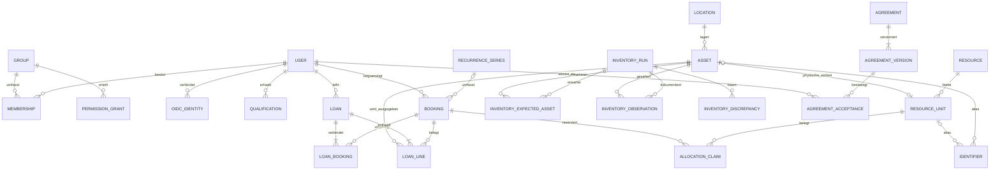

# Datenmodell — produktive Grundlage und spätere Fachdomänen

Alle Fachobjekte besitzen stabile UUIDs, Erstellzeit und geeignete Änderungsrevision. Löschregeln sind ausdrücklich festzulegen; historische Ausleihen, Zustimmungen und Versionen werden nicht durch Cascade gelöscht.

## Entitäten und Integrität

| Entität | Zentrale Felder / Integritätsregeln |
| --- | --- |
| User / BorrowerProfile | normalisierte eindeutige E-Mail, verification_at, active, system_admin, employee_marker; Name, strukturierte Anschrift, Telefon; Profilrevision. Registrierung nur E-Mail/Passwort; Pflichtprofil vor verbindlicher physischer Ausleihreservierung, nicht pauschal für Raum-/Maschinenzeit. ResourcePolicy kann weitere Anforderungen definieren. Kein unregistrierter BorrowerContact. |
| IdentityCheck | Benutzer, checked_at, checked_by, Methode Vor-Ort-Ausweisprüfung; keine Dokumentnummer, Kopie oder Geburtsdatum. Erste Ausgabe und Prüfung atomar. Korrekturen als Audit, nicht heimliches Überschreiben. |
| OIDCIdentity | eindeutiges Paar issuer+subject, User-FK; E-Mail ist kein Identitätsschlüssel. |
| Group / Membership / PermissionGrant | frei benannt; Aktion, genau ein scope (global/resource/category/location), optionale validierte Regeln; belegbare delegierte Obergrenze. Membership mit Historie. |
| QualificationType / UserQualification | Ressource/Kategorie, erteilende Person, Datum; im Pilot weder Ablauf noch Entzug. Falsche Erfassung nur privilegierte audierte Datenkorrektur, keine versteckte Entzugsfunktion. |
| Location / Asset | parent-FK ohne Zyklen; Asset mit eindeutiger Inventarnummer, optionaler Seriennummer, Zustand, Lebenszyklus und Ort. Kosten separat geschützt. |
| AssetRelation / AssetEvent | typisierte Kante, keine Selbstkante; part-of/Kit azyklisch. Bewegungen und Entsorgung historisch. |
| CustomFieldDefinition / Value | Typ, Sichtbarkeit, Validierung; eine typgerechte Value-Spalte pro Datentyp, unique asset+definition. Kein unvalidiertes JSON für Kerndaten. |
| Resource / ResourceUnit | Resource-Typ, Sichtbarkeit, Policy, location; Unit optional genau ein Asset. Physisches Asset höchstens eine aktive Unit, damit zwei Angebote nicht unabhängig dieselbe Sache versprechen. Raum-Unit logisch. |
| PoolMembership / BundleComponent | Pool hat Units; Bundle verweist auf Angebote/Pool mit Anzahl und required. Keine Zyklen; konkrete Asset-Kollisionen innerhalb eines Bundles deduplizieren oder als ungültige Konfiguration ablehnen. |
| Schedule / Exception | Zeitzone, Wochentag, lokale Zeitfenster, Zweck opening/pickup/return/usage; Ausnahmen mit Datum und Priorität. |
| BookingPolicy | Zeitmodus, Granularität, Dauer, Vorlauf, Horizont, Puffer, Nutzungslimits, Genehmigung; Revision und aufgelöster Snapshot. |
| Booking / Event | actor, beneficiary, Resource, Start/Ende, lokale Datumsfelder bei Tagesausleihe, Status, Revision, policy_snapshot; Ende nach Anfang. |
| AllocationClaim | Unit-FK, tstzrange, Kind reservation/hold/maintenance/custody, aktiv, genau ein Eigentümer; GiST-Exclusion auf unit und überlappende aktive Bereiche. Siehe BOOKING_ENGINE.md für Gewahrsam. |
| Loan / LoanBooking / LoanLine | registrierter borrower, actor, expected_return; mehrere Bookings über LoanBooking (unique loan+booking), eine Line je physischem Asset mit genauem Booking-/Allocationbezug, issue/return, Zustand, Zubehörstatus. Teilrückgabe je Line. Spontanausleihe erzeugt Booking/Allocation und Loan atomar; vorhandene Reservierung wird wiederverwendet. |
| RecurrenceSeries | lokale Startzeit, TZ, erlaubte RRULE-Teilmenge, count/until, Status, Revision; Occurrence unique series+original_local_occurrence_key. |
| Agreement / AgreementVersion | Titel, Zweck, draft/published/retired; Version mit unveränderlichem Text, Versionsnummer, hash, published_at/by. Eindeutig document+version. |
| AgreementRequirement | globale Ausleihpflicht oder genau eine Resource/Asset-Zuordnung, Agreement-FK. Mehrere je Item; keine Zuordnung auf wechselbaren Freitext. |
| AgreementAcceptance | unique user+version, accepted_at, bestätigender User; keine stellvertretende Zustimmung durch Personal. |
| BookingAgreement / LoanAgreement | Nachweis der konkret zum Vorgang verlangten und akzeptierten Versionen, nicht nur Verweis auf aktuell neueste Version. |
| InsuranceDeclaration | User, Zeitpunkt, unveränderliche Erklärungstextversion, optionale expires_at für spätere Policy; initial unbegrenzt gültig bis erforderliche neue Textversion. Ausgaben referenzieren bestehenden Nachweis; keine erneute Bestätigung je Ausgabe. Keine Versicherungsgesellschaft, Police oder Versicherernummer. |
| AuditEvent / Outbox / IdempotencyRecord | Actor, Aktion, Objekt-ID, minimaler diff, Request-ID; Outbox unique event+channel; Idempotenz unique actor+operation+key plus payload-hash und Ergebnis. |

Medien haben Owner, Dateityp, Größe, Sichtbarkeit und Scanstatus. Öffentliche Resource-Galerien sind ausdrücklich veröffentlichte Kopien/Referenzen, niemals automatisch die gesamte Asset-Dokumentation.

## Wiederverwendung, Historie und Datenschutz

Vereinbarungspflichten sind die deduplizierte Vereinigung aus globaler Ausleihe, Angebot, ausgewähltem Asset und allen ausgegebenen Bundle-Komponenten. Pools erfordern späteste Prüfung bei konkreter Zuweisung; technische Empfehlung ist konkrete Zuweisung schon bei Bestätigung. Anforderungen werden bei Ausgabe frisch aufgelöst.

Booking/Loan speichern nur die fachlich notwendige Profilrevision/Referenz; kein unbeschränkt vervielfältigtes Adressarchiv. Ob ein unveränderlicher Vertragsadresssnapshot notwendig ist, bleibt Privacy-Review. Geschlossene Vorgänge werden nach freigegebener Retentionsregel pseudonymisiert, offene Ausleihen nicht automatisch gelöscht. Audit enthält keine Ausweisdaten.

## Schema-Gates

Vor Migrationen: Claim-Constraints und Gewahrsamstrategie per PostgreSQL-Prototyp bestätigen; Grant-Algebra freigeben; Versionierungs-/Retentionsmodell prüfen. Indizes: active claims nach unit/range, bookings beneficiary/start/status, LoanLine offene Assets, memberships user, scoped grants, outbox next_attempt. Kein SQLite-Ersatz für Integritätstests.

## Identifier, Scanner und Inventur — konzeptionelle Erweiterung 15.10.2026

Die folgenden Tabellen beschreiben das Gesamtziel für Phase 3/4/6/10. Asset-Identifier und Namespaces sind in Phase 3 implementiert; ResourceUnit, InventoryRun und Loan bleiben spätere Fachmodelle. [ADR-011](docs/adr/011.md) trennt bindende Owner-Anforderungen von technischen Empfehlungen. Im ERD gilt für Identifier eine XOR-Zielbeziehung, die das Diagramm allein nicht ausdrückt.

| Entität | Felder und vorgeschlagene Constraints |
| --- | --- |
| IdentifierNamespace | stabile ID, eindeutiger Namespacekey, Issuer/Format, Normalisierungsversion; administrativer Parserkontext, keine zweite Organisation/Tenant. |
| Identifier | UUID, namespace-FK, canonical_value, code_type, optional asset-FK oder resource_unit-FK, active, created_by/at, retired_at/reason. Genau ein Ziel per XOR-CHECK; alle FKs echt, keine freie polymorphe Objekt-ID. Mehrere Identifier je Ziel; Unique(namespace, canonical_value) auch für inaktive Werte, keine Wiedervergabe alter Etiketten an andere Objekte. Nichtleerer begrenzter Wert; führende Nullen erhalten. |
| InventoryRun | UUID, Titel, Status draft/active/completed/cancelled, typisierter Scope (organization/location/category) mit expliziten FK-/Scopechecks, started_at, completed_at, actor und Revision. Erwartungsbasis beim Start dokumentieren. |
| InventoryExpectedAsset | run-FK, asset-FK, erwarteter Standort, Assetrevision/Lifecycle bei Start, unique(run,asset). Snapshot enthält auch nicht verleihbare Assets; Borrower-/Kontaktdaten werden nicht kopiert. |
| InventoryObservation | run-FK, asset-FK, tatsächlich gewählter Beobachtungsort, Actor, server observed_at, Request-/Workflow-ID und payload-hash. Idempotenz auf run+actor+request key; abweichender Payload bei gleichem Key ist Konflikt. Mehrere echte Beobachtungen möglich, erstes Seen erhalten. |
| InventoryRunAssetSummary | unique(run,asset), first_seen, last_seen, Wiederholungs-/Abweichungsflags als Projektion. Aliase werden auf Asset-ID kanonisiert, nicht pro Barcode gezählt. |
| InventoryDiscrepancy | run, asset, erwartet/beobachtet, Art (Standort, unerwartet, ungeklärt), Status, Entscheidung, entschieden von/wann; expliziter move-Eventbezug nur bei berechtigter Stammdatenänderung. |
| InventoryAssessment | Abschlussbewertungszeit, Assetbezug, seen/expected/location_flags, zu diesem Zeitpunkt tatsächlicher Custodybezug/Status. Historische Loanereignisse auswertbar; „nicht gesehen“ ist kein automatischer Vermisststatus. |
| WorkflowContext / optional Device | Konzept für spätere Kiosk-UI: Actor, optional Beneficiary, Kanal/Modus, Kontextrevision und Ablauf; Device nur optionale eigene Identität/Metadaten ohne inhärente Grants. Keine Device-Fachtabelle oder Self-Service-Auth in Phase 1 nötig. |

PostgreSQL-Grundregeln für Identifier: `(asset_id IS NULL) <> (resource_unit_id IS NULL)` erzwingt genau einen Ziel-FK; `UNIQUE(namespace_id, canonical_value)` schützt parallele Aliaszuordnung. Parser und Unique-Index müssen dieselbe versionierte Normalisierung verwenden. Zielwechsel eines bereits gedruckten Identifiers ist kein gewöhnliches Update; Korrektur/Stilllegung ist ausdrücklich berechtigt und auditiert, nicht stiller Etiketten-Reuse. Eine gleichzeitige Anlage darf genau einen Gewinner haben, andere erhalten einen verständlichen Konflikt. Kein Unique-Constraint nur auf den aktivierten Teil, der alte Labels neu vergeben ließe.

Physische Labels bevorzugt am Asset, Unitlabels vor allem für logische Einheiten. Ist eine Unit mit Asset verknüpft, liefert der Resolver die kanonische physische Identität; Aliasvarianten dürfen weder doppelte LoanLines noch doppelte Inventurzählung erzeugen. Änderungen dieser Verknüpfung benötigen Revisionsprüfung und explizite Behandlung bestehender Codes, keine heimliche Neudeutung eines physischen Etiketts. Ein Hersteller-Produktbarcode, der mehrere konkrete Assets trifft, wird nicht als eindeutig auflösbarer Einzelassetidentifier gespeichert.

LoanBooking und LoanLine.Booking-/Allocationbezug erhalten originale Reservierungen auch bei einer gemeinsamen Ausgabe. Alle Bookings eines Loans müssen denselben Beneficiary haben; Line muss zum zugehörigen Asset/Claim und einer verknüpften Buchung gehören. Wo durch zusammengesetzte FKs/Unique abbildbar, DB-seitig absichern; übrige Cross-Object-Regeln unter den zentralen Service-/Unitlocks prüfen. Kein alleiniger Loan.booking-FK, der bei mehreren Reservierungen Daten verlieren würde.

Inventurgrundlage und Beobachtung trennen: unique Run/Asset-Snapshot und separate Beobachtungen. Ein FK allein verhindert weder neue Scans nach Runabschluss noch Standort-/Custody-Races; dafür Runstatus und Revision unter gemeinsamem Lock prüfen, Abschluss gegen Scan/Move/Return/Checkout testen. Erwartungssnapshot, Seenstatus und Ausleihbewertung haben ausdrücklich dokumentierte Zeitgrenzen. Selbst zurückgegebene, aber nicht gescannte Assets werden nicht automatisch als vermisst deklariert; reguläre Ausleihe während des Runs bleibt aus Historie nachvollziehbar.

Vor Fachmigrationen: Namespace-/Parserkontrakt und Bestandsmigration vorhandener Inventarnummern festlegen; Kollisionen vor Import anzeigen, nichts überschreiben. Bei bereits vorhandenem Assetbestand Identifier als additive Tabelle befüllen, interne UUID und alte Anzeigenummer erhalten. Phase 1 hat noch keine Fachmigrationen. Retention für Inventur-/Aliasänderungsaudit nach bestehenden Privacy-Gates, nicht unbegrenzt personenbezogene Lookuphistorie speichern.

Phasenfähige Migration: Phase 3 implementiert zunächst die Asset-Identifier mit echter Asset-FK und NOT NULL. Sobald ResourceUnit in Phase 4 vorhanden ist, wird die Registry additiv um die Unit-FK und den XOR-CHECK erweitert; keine freie UUID auf eine noch nicht existierende Tabelle und keine vorgezogene vollständige Ressourcenimplementierung. Namespace und kanonischer Code behalten ihren bisherigen Unique-Schlüssel. Textvergleich und Resolver verwenden dieselbe deterministische Vergleichssemantik; Normalisierungsänderungen brauchen Kollisionspreview und explizite Datenmigration, kein stilles Neuinterpretieren vorhandener Codes.

## Phase-3-Schema und Migrationen

Produktiv implementierte Grundlage: Location und Category mit optionalem parent-PROTECT, Name/Beschreibung/Aktivstatus/Revision; Asset mit UUID, permanenter Inventarnummer, Name/Beschreibung, Kategorie, Tags, Hersteller/Modell, Seriennummer, Anschaffungsdatum/-wert, Standort, getrenntem Zustand/Lebenszyklus, internen Notizen und Archivzeit. Zustand: good/worn/damaged/inspection; Lebenszyklus: active/unavailable/maintenance/retired/lost. Die begrenzten technischen Zustände sind in ADR-014 begründet; frei benannte Kategorien und Tags bleiben konfigurierbar.

Identifier hat derzeit genau eine echte NOT-NULL-Asset-FK. Unique(namespace, canonical_value) gilt auch für stillgelegte Codes. C-Kollation und versionierte ASCII-Normalisierung bewahren führende Nullen und unterscheiden Groß-/Kleinschreibung im exact-v1-Namespace. UsedNamespace und Ziel/Code eines Identifiers bleiben unveränderlich; Löschen, Reaktivierung und Wiedervergabe sind ausgeschlossen. Deelvo-Codes bestehen aus `DLV-` und 96 zufälligen Bits. Standardnamespaces `deelvo` und `inventory` werden migriert.

AssetMovement hält Actor, Grund, Zeitpunkt, Quell-/Ziel-FK sowie damalige Pfade. CustomFieldDefinition definiert text/number/date/boolean/enum/url, Optionen und sensible Sichtbarkeit; CustomFieldValue enthält genau eine typgerechte Wertspalte je Asset/Definition. DB-Trigger sichern Typen und verhindern nachträgliche Umdeutung verwendeter Definitionen. AssetMedia enthält private zufällige Speicherreferenz, Typ/Größe, sensible Sichtbarkeit (Standard), Actor und Archivierung. ImportPreview gehört einer Person, enthält validierte Zeilen, eine Stunde Ablauf sowie nach Bestätigung erzeugte IDs; keine Vorschau erzeugt Assets.

Migrationen: inventory 0001 initiale Modelle, 0002 Bäume/Identifier-Integrität und Standardnamespaces, 0003 Mediensichtbarkeit/C-Kollation, 0004 Registry-Lock und typisierte Werte. PostgreSQL-Advisory-Locks sichern direkte SQL-Baum-/Registryänderungen zusätzlich zum zentralen Service-Autorisierungslock. Keine Datenmigration existierender produktiver Inventare behauptet; neue Migrationen wurden lokal mit synthetischen Daten geprüft. Vor Produktion sind Backup/Restore und PostgreSQL-17-CI erforderlich. Rücknahme der Inventartabellen verliert Daten; daher kein destruktives `migrate inventory zero` als Betriebsrollback. Forward-Fix oder abgestimmter Restore von DB und Medien.

Nicht implementiert: AssetRelation/Template, Wartungsplanung, Resources/Units, Buchungen/Ausleihen, Inventurläufe und Feed-/API-Tokenmodelle. Das konzeptionelle ERD zeigt diese Zielstruktur, keinen aktuellen vollständigen Migrationsstand.

## Phase-4-Schema

ResourceType (UUID/key/name/active), Resource (UUID/stabiler Slug, Titel/Katalogtexte, öffentliche Ortsangabe, interner Standort, Typ, Kategorien/Tags, private/public, separate Publikationszeit, Booking-Konfiguration, Featureflag, Revision/Zeiten/Archiv), ResourceUnit (UUID, permanente Resource-FK, optionale permanente OneToOne-Asset-FK, Name/active/revision), ResourcePool und PoolMembership (Unit höchstens ein Pool, gleicher Resource-FK per DB-Trigger) sind jetzt implementiert. ResourceImage besitzt eigene reenkodierte Datei/Alttext/Größe/Actor/Archiv und referenziert keine privaten AssetMedia-Dateien.

Migrationen: resources 0001, inventory 0005 (nullable Asset-FK plus Unit-FK/XOR), resources 0002 (erweiterter Identifier-Identityguard, Unit-/Pool-/Resourceidentität). Bestehende Asset-Identifier bleiben unverändert und erfüllen XOR. Physische Unitzuordnung bleibt auch nach Deaktivierung einmalig. Kein ResourceUnit == Asset. Pool-Einsatzfähigkeit wird aus aktivem Kontext/Units/Assetzustand abgeleitet, ist aber keine zeitliche Verfügbarkeit.

Rückmigration zu NOT-NULL Asset ist nach Anlage logischer Unitcodes nicht ohne Datenverlust möglich. Kein Zurückmigrieren oder Entfernen dieser Codes als normaler Rollback: abgestimmter DB-/Medienrestore oder Forward-Fix. Älterer Phase-3-Code kann nullable Unit-Identifier nicht korrekt interpretieren und ist nach produktiver Nutzung dieser Migration kein sicherer Drop-in-Rollback. Produktion/Restore bleibt separates Gate.

## Implemented Phase-5 schema

BookingPolicy has a Resource OneToOne PK, explicit onsite/physical_loan and slots/days modes, timezone, timing/limit/gate fields and revision. ScheduleWindow and ScheduleException have exactly one Resource/Location owner and a typed purpose (usage/access/opening/pickup/return). ResourceBlock stores a positive UTC interval, current revision, actor and reason.

Booking stores immutable actor, beneficiary, Resource, concrete Unit, UTC interval, optional inclusive-start/exclusive-end local dates, timezone and policy snapshot. Status/revision update through services. AllocationClaim is OneToOne to Booking with real Unit FK and finite, bounded, nonempty half-open tstzrange. Active Unit/range pairs exclude overlap. Deferred constraints require exactly one matching claim with activity consistent with confirmed/active versus cancelled/completed; identity/range/history cannot be rewritten or deleted. IdempotencyRecord is unique actor+operation+UUID-key with canonical payload hash and Booking FK. BookingIncident preserves review needs without cancelling a promise.

Migrations bookings/0001–0003 add independent tables, reviewed btree_gist, identity/lifecycle triggers and finite bounds. Existing inventory/resource/identifier records are preserved. [Migration and rollback procedure](docs/DEVELOPMENT.md). No Loan schema or physical custody writes in Phase 5.

## Phase 6 implemented additions

Agreement kinds general/insurance/additional; immutable published AgreementVersion plus unique Acceptance(user,version). Multiple AgreementAssignments have exactly one Resource/Asset owner. IdentityCheck is one permanent minimal actor/time proof per User. Appointment is one pickup/return pair per physical Booking. Loan owns registered borrower/actor/issue/closure/evidence; LoanLine references exactly one original Booking, concrete Unit and Asset, expected and actual return, condition/accessory evidence and revision. Multiple lines preserve separate original Booking links and independent returns. Conditional uniqueness forbids two open lines per Unit or Asset.

Extensions append immutable old/new ends/dates, actor/reason/revision/current policy evidence. Additive guards permit only a matching positive end/claim growth; original start/identity/snapshot stay immutable. LoanOperation key is actor+kind+UUID with canonical payload hash, bound to Loan. Booking adds terminal no_show; no physical return is inferred. Deferred constraints require actual lines and closure consistent with line returns, and custody consistent with Booking status. Original migrations remain unchanged. [Operator migration notes](docs/DEVELOPMENT.md).

## Phase 8 — non-blocking proposals and permanent occurrence identity

`ReservationRequest` retains original actor/beneficiary, resource membership,
local timezone/mode, bounded weekly rule, expected occurrence count, options,
idempotency digest/key, revision and explicit decision actor/time/reason.
`RequestOccurrence` retains original local start/end and position; approved
occurrences link to their original root Booking, with ordinary bundle membership
for its components. Requests have no AllocationClaim/Loan. `RequestAdjustment`
appends pending changes/omissions; `OccurrenceException` links cancelled originals
to replacement bookings after approval. All history remains permanent.

Additive bookings/0011–0012; existing Bookings, Claims, Loans and consent evidence
are not rewritten. Deferred PostgreSQL guards enforce complete request occurrence
sets and complete approved linkage, immutable identities and terminal decisions.
[ADR-023](docs/adr/023.md) documents local expansion, approval and exception rules.

## Phase 9: notification/publication records

Notifications migrations 0001/0002 add settings (singleton), bounded versioned
plain-text templates, personal locale/optional preference, encrypted Delivery
outbox with unique idempotency key/leases, CalendarFeed with hashed expiring
credential and immutable scope, and CalendarRevision for monotonic public
projection sequence. SQL guards protect outbox identity/terminal state and feed
identity/revocation. No existing Booking/Loan/consent is rewritten. See
[ADR-024](docs/adr/024.md) for retention, key rotation and publication semantics.

## Phase 10 implemented records

InventoryRun: immutable scope/creator, draft → active → completed/cancelled,
materialized ExpectedAsset, append-only Observation with request UUID, separate
Discrepancy decision and frozen JSON assessment. MaintenanceTask: asset, kind, due
date/interval, explicit assignee, attachments and immutable terminal result; unique
previous-task link prevents duplicate follow-ups. StaffedContext is an expiring
owner/session interaction generation, not an authentication/device grant. SQL
guards and existing global write lock protect close/scan/move/custody boundaries.

## Phase 11 additive integration records

IntegrationClient(owner, immutable capabilities/scope), IntegrationToken(SHA-256
digest, immutable capability/readonly/expiry ceiling, irreversible revocation),
APIImport(client-bound native ImportPreview). SQL triggers preserve their history.
OIDCStateUse stores only hashed one-time state and expiry, not provider tokens.
No existing inventory/resource/booking/loan data is rewritten.
