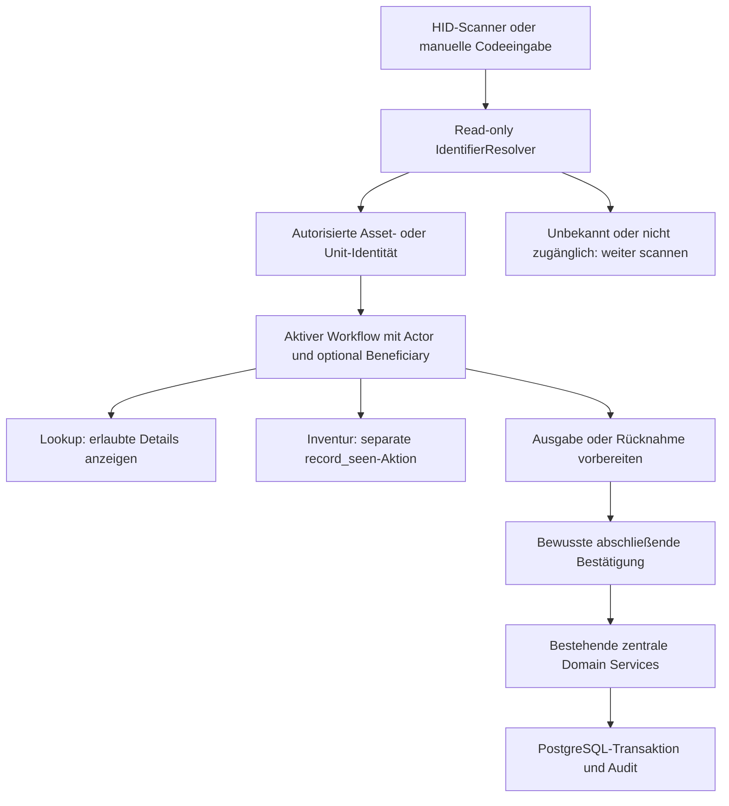

# Kiosk, Scanner und Inventur — Architekturergänzung vom 15.10.2026

Quelle: [verbindliche Owner-Anforderung](OWNER_REQUIREMENT_KIOSK.md). Bereits freigegebene Buchungs-, Gruppen-, Identitäts- und Agreement-Regeln gelten unverändert. **Phase 1 berücksichtigt Architektur und Constraints; die Kiosk-Fachoberfläche wird jetzt nicht implementiert.**

## 1. Identifikation und Aktion

Der IdentifierResolver schreibt weder Booking, Loan, LoanLine, Gewahrsam, Standort noch Inventurbeobachtung. Er identifiziert; ein danach aufgerufener autorisierter Workflow-Service führt die passende Aktion aus. Das gilt auch dann, wenn die Oberfläche im Inventurmodus nach jedem Scan unmittelbar `record_seen` anfordert.

Physische Codes verweisen bevorzugt auf Assets, unabhängig von deren Buchbarkeit. Eine zugehörige ResourceUnit wird über die explizite aktuelle Asset-Verknüpfung gefunden. Logische Units können eigene Codes erhalten. Ein Asset wird durch Scan niemals automatisch Resource oder verleihbar. Rückgabe findet offene LoanLines über die tatsächliche Asset-/Unit-Identität, nicht über einen eingebetteten Loan- oder Benutzercode.

## 2. Identifier und Resolververtrag

Asset und ResourceUnit behalten ihre internen UUIDs. Zusätzliche Identifier sind Aliase mit eigenem Typ, Namensraum, normalisiertem Wert, Ziel-FK und Aktivierungsstatus. Mehrere Aliase desselben Assets sind erlaubt. [Datenmodell](../DATA_MODEL.md) und [ADR-011](adr/011.md) beschreiben FK-/Unique-/CHECK-Constraints.

Vorgeschlagene eigene Etiketten: opake Zufallstoken mit mindestens 128 Bit Entropie und erkennbarem Formatprefix, ohne Person, Konto, Standort, Kosten, Ausleihstatus oder Berechtigung. QR kann den Token oder eine eigene HTTPS-Lookupadresse enthalten. Ein Code ist kein Authentifizierungs- oder Zugriffstoken. Eine sichtbare Inventarnummer bleibt ein separater, bei Bedarf als Alias registrierter Wert.

Bestehende Hersteller-/Organisationscodes sind nur dann als Objektidentifier zulässig, wenn sie eine konkrete Einheit eindeutig bestimmen. Ein mehrfach aufgedruckter Produkt-EAN identifiziert häufig nur einen Produkttyp: bei Mehrdeutigkeit keine automatische Auswahl; individuellen Alias vergeben oder den Code nur als Produktmerkmal führen. Namensräume und deren Scannerkontext werden administrativ konfiguriert. Ein unpräfixierter Code ohne eindeutigen Kontext darf nicht willkürlich auf das erste Suchergebnis fallen.

Vorgeschlagener Vertrag: `resolve(code, namespace_context, actor)` liefert `identified` mit minimalen autorisierten IDs und Typ, `not_found_or_not_accessible`, `invalid_code` oder `ambiguous_code`. Reine Auflösung verlangt kein Checkoutrecht; nachfolgende Details und Aktionen prüfen ihre jeweiligen Grants. Verfügbarkeit und Borrowerdaten werden nicht ungeprüft im Resolverpayload mitgeliefert. Vor Commit erneut auflösen bzw. Zielrevision/Zuordnung prüfen, damit ein zwischenzeitlicher Alias-/Assetwechsel keine falsche Ausgabe bewirkt.

Normalisierung ist typisiert und versioniert. Scanner-Enter ist ein Transportabschluss, kein Teil des gespeicherten Codes. Führende Nullen und Groß-/Kleinschreibung bleiben erhalten, solange die jeweilige Codespezifikation nichts anderes vorsieht. Keine pauschale Zahlenkonvertierung oder stilles Casefolding. Unique gilt auf genau dem Schlüssel, den der Resolver verwendet. URLs werden nur als validiertes eigenes Format geparst, nie serverseitig abgerufen oder als beliebiger Browserlink geöffnet. Zeichen-/Längenregeln und akzeptierte Organisationsorigins werden vor Phase 3 konkret festgelegt; Vorschlag: maximal 256 Zeichen für rohe Codeeingaben, Formatprefixe ausdrücklich parsen.

## 3. Eingabe und Scannerfokus

Erste Unterstützung: USB-/Bluetooth-HID im Tastaturmodus mit Enter, identische manuelle Eingabe als Fallback. Keine proprietäre SDK-Pflicht, keine Kamera-Pflicht. Scannerlayout/Prefix/Suffix müssen bei Einrichtung getestet werden; nicht jeder Scanner ist identisch konfiguriert.

Sichtbares beschriftetes Scan-Feld im aktivierten Workflow. Nach Verarbeitung oder unbekanntem Code wieder bereit. Schnelle Scans werden mit stabilen Request-IDs und begrenzter FIFO-Verarbeitung dem aktuellen Kontext zugeordnet; langsame Antworten dürfen keinen neu gewählten Beneficiary oder Modus beeinflussen. Doppelter Scan derselben physischen Einheit addiert keine zweite Ausleihposition. Fokus nicht aus einem bewusst geöffneten Such-/Notizfeld oder Dialog stehlen; aktiver Scanstatus und „Scanner fortsetzen“ bleiben sichtbar. Kein globaler Keyboard-Hook, der Passwörter oder allgemeine Tastatureingaben als Scans abfängt.

Klare visuelle Rückmeldung pro Scan, auch bei unbekannten, unzulässigen und bereits erfassten Assets. Fehler unterbrechen den Gesamtworkflow nicht. Große Touchziele, Tastaturbedienung, Statusmeldungen für Screenreader, keine allein farbige Rückmeldung, keine unnötigen Modals. Audiofeedback ist später optional.

## 4. Ausgabe, Abholung und spontane Ausleihe

1. Berechtigter Actor aktiviert den Ausgabekontext und wählt einen registrierten Beneficiary.
2. Scans füllen einen vorläufigen Korb aus konkreten Assets/Units; jeder Eintrag zeigt Zustand, Reservierungszuordnung und offene Voraussetzungen. Kein Scan eröffnet Gewahrsam oder eine verbindliche Reservierung.
3. Passende bestätigte Reservierung für Beneficiary, Unit/Pool und Abholzeit suchen. Bei mehreren Kandidaten ausdrücklich wählen. Die vorhandene Buchung nutzen; keine zweite unabhängige Buchung erzeugen.
4. Ohne passende Reservierung Spontanausleihe vorbereiten. Nur tatsächlich verleihbare Angebote mit den normalen Policies; erwartete Rückgabe und erforderliche Termine erfassen. Reines Inventar ist dadurch nicht verleihbar.
5. Vor Abschluss vollständige Prüfung: Actor-Grant und Beneficiary-Berechtigung, aktives Konto, Pflichtprofil, erforderliche AgreementVersionen, gültige Haftpflicht-Selbsterklärung, erste dokumentierte Ausweisprüfung, Qualifications, Zeitpläne, ResourcePolicy, Reservierungen, Sperren, Verfügbarkeit und offener Gewahrsam. Personal bestätigt keine Benutzerzustimmungen stellvertretend.
6. Actor bestätigt bewusst. Zentraler Checkout-Service prüft unter den bisherigen Locks erneut; für spontane Positionen entstehen Booking/Allocation und danach Loan/LoanLines **in derselben Transaktion**. Konflikt in einer erforderlichen Position rollt alle in diesem Abschluss neu erzeugten oder geänderten Datensätze zurück; bereits vorher bestätigte Reservierungen bleiben unverändert bestehen. Gewünschte Teilmenge muss vorher ausdrücklich ausgewählt werden, keine stille Teilausgabe.
7. Idempotenz schützt Retry/Doppelklick; auditierbar bleiben Actor, Beneficiary, Assets/Units, Buchungsbezüge und Workflow. Nach Erfolg Korb und sichtbare Personendaten leeren.

Mehrere gescannte Gegenstände können zu einem Loan mit mehreren LoanLines gehören, auch wenn sie aus mehreren ursprünglichen Bookings stammen. Datenmodellvorschlag: `LoanBooking` und Booking-Bezug pro LoanLine; keine Reduktion auf einen unzureichenden Loan.booking-FK. Fehlende Pflichtkomponenten eines Bundles müssen vor Bestätigung sichtbar sein. Poolersatz verwendet die bestehende atomare Neuzuordnung und neue erforderliche Agreementprüfung.

## 5. Rücknahme

Scan → autorisierte offene LoanLine suchen → notwendige Borrower-/Loaninformationen, erwartete Rückgabe, Überziehung und weitere Positionen desselben Loans anzeigen. Datenschutz am öffentlich einsehbaren Gerät begrenzt Details; Kontaktdaten brauchen eigenes Grant.

Scans bereiten Rücknahme vor; Personal bestätigt Zustand, Schäden und Notizen und schließt ausgewählte Lines explizit. Bereits zurückgegebene/erneut gescannte Lines werden als solche angezeigt, nicht doppelt verarbeitet. Nicht zurückgegebene Komponenten bleiben offen. Gesamter Loan erst returned, wenn alle Lines tatsächlich zurückgegeben oder durch ausdrücklich berechtigte Verlustauflösung abgeschlossen sind. Schaden erzeugt Wartung/Sperre gemäß bestehendem Service. Ein gesperrtes Borrowerkonto verhindert keine autorisierte Rücknahme. Scan oder geplanter Rückgabetermin allein beendet nie Gewahrsam.

## 6. Inventur und Standortkontrolle

Vorgeschlagenes Modell: `InventoryRun`, Scope und Erwartungssnapshot, `InventoryExpectedAsset`, `InventoryObservation`, `InventoryDiscrepancy`. Scope kann Organisation, Gebäudeteil/Ort einschließlich konfigurierter Nachfahren oder Kategorie sein. Run: draft → active → completed/cancelled. Vor Start Vorschau und Scopeberechtigung prüfen; nicht verleihbare Assets sind normale Teilnehmer.

Beim Start erwartete Asset-IDs, damalige Standorte und relevante Revisionen materialisieren, statt die Erwartungsliste nach jedem Umzug unbemerkt zu ändern. Aktuellen Beobachtungsort ausdrücklich wählen; dessen Auswahl verlegt keine Assets. Ein Scan ruft nach Identifikation `record_seen` mit Run, Asset, Beobachtungsort, Actor und serverseitigem Zeitpunkt auf. Wiederholte Requests sind idempotent; mehrfaches Scannen über verschiedene Aliase zählt nicht als mehrere Assets. Erster Fund bleibt nachvollziehbar, weitere echte Beobachtungen können abweichende Fundorte ergänzen.

Rückmeldung: erwartet/gefunden, falscher Standort, bereits gescannt, unbekannter Code, außerhalb Scope. Erkanntes Asset außerhalb Scope als unerwarteten Fund nur bei passenden Leserechten/Beobachtungsrechten dokumentieren; Scope nicht still erweitern. Unbekannte Codes erlauben Weiterscannen und administrative Suche/Zuordnung; kein automatisches Asset-Anlegen.

Standortabweichung ist zunächst eine Discrepancy. Berechtigte Person entscheidet explizit: autorisierte Standortänderung über Inventory-Service mit Audit und Revisionsprüfung, temporärer Fund oder spätere Klärung. Ein reiner record_seen-Aufruf ändert den Stammdatenstandort niemals.

Abschlussbericht unterscheidet erwartete, gesehene, nicht gefundene, falsch lokalisierte und unerwartete Assets sowie tatsächlichen Gewahrsam. „Nicht gesehen“ ist nicht automatisch „vermisst“. Empfehlung: feste Abschlusszeit und aktuelle Custody-Auswertung an dieser Grenze dokumentieren; zusätzlich historischen Loanstatus zur Scanzeit abrufbar halten. Regulär ausgeliehene Assets separat ausweisen, nicht als vermisst bewerten. Überfällige Ausleihen separat kennzeichnen, ohne Gewahrsam zu erfinden oder Ausleih-/Vermisststatus gleichzusetzen. Berichte speichern Bewertungszeit und Referenzen, damit spätere Rückgaben einen abgeschlossenen Bericht nicht rückwirkend verändern.

Runabschluss und neue Beobachtungen serialisieren am Runlock; nach Abschluss keine stillen Scans. Standortänderungen/Checkout/Rückgabe benötigen konsistente Revisionen bzw. gemeinsame Asset-/Unitlocks für die Abschlussbewertung. Konkrete Lockreihenfolge und Snapshot-Semantik vor Phase 10 gegen PostgreSQL testen. „Als vermisst markieren“ ist eine getrennte berechtigte Entscheidung, kein automatischer Inventurabschluss-Effekt.

## 7. Actor, Beneficiary, Gerät und Datenschutz

Kiosk ist ein Interaktionskanal. Angemeldeter Actor, Beneficiary, optional registriertes Device und gewählter Modus bleiben getrennt. Geräte-ID, lokaler Browsermodus, IP oder gescannter Assetcode verleihen keine Rechte. Staffed Kiosk und Inventory Terminal verwenden normale Benutzeranmeldung und scoped Grants. Self-Service bleibt bis eigener Spezifikation deaktiviert; konkrete Authentifizierung/Device Trust sind kein Phase-1-Auftrag.

Alle Oberflächen/API rufen dieselben Domain Services auf. Scanvorbereitung ist keine Autorisierung für einen späteren Commit. Jeder mutierende Aufruf hat CSRF-/Sessionprüfung, Objektberechtigung und erneute fachliche Validierung. Eine allgemeine Kioskberechtigung ersetzt keine checkout/return/inventory-/Identifierrechte.

Nach Vorgang, Abbruch und Modus-/Beneficiarywechsel transienten Kontext, Personenanzeige, Scanqueue und veraltete Antworten verwerfen. Staffed Kiosk darf die Staffsession nach Verfahren behalten, braucht aber Inaktivitätssperre; Self-Service benötigt serverseitigen Sessionreset/Tokeninvalidierung, Inaktivitätstimeout und Schutz gegen Zurücknavigation/alte Request-IDs. Sensible Antworten nicht öffentlich cachen, keine PII im localStorage/IndexedDB oder in Codes. Routine-Lookups müssen nicht dauerhaft personenbezogen protokolliert werden. Relevante Änderungen bekommen Auditkontext einschließlich Workflow; Geräteangaben nur bei echtem Bedarf.

Kein Offline-Commit für Booking, Checkout oder Return. Bei Verbindungsabbruch Zustand als ungeklärt anzeigen, mit demselben Idempotenzkey serverseitig Ergebnis prüfen; keine Erfolgsmeldung aus lokalem Korb und kein stilles Offline-Replay. Offline-Inventur bleibt ein separates späteres Design.

## 8. Phasen und Nachweise

Phase 1: diese Dokumente und ADR-011, keine Kiosk-UI/Identifier-Fachmigration. Phase 2: Action-/Scope-Infrastruktur berücksichtigt Kioskaktionen und getrennten Kontext. Phase 3: Identifiermodell, Legacy-Codezuordnung, manuelle Eingabe, Asset-Suche/Lookup. Phase 4: Unit-Verknüpfung/Resolverprojektion. Phase 6: HID-unterstützte Ausgabe, Abholung, spontane Ausleihe, Rücknahme/Teilrückgabe; vorhandene Qualifikationsregeln nie umgehen. Phase 7 erweitert Pool-/Bundlefälle. Phase 10: Inventory Runs, Beobachtungen und Abschlussberichte. Anschließend abgegrenztes Kiosk-UI-Inkrement mit Touch/Fokus/Sessionreset; vor Pilot verbindlich testen. Self-Service erst nach eigenem Auth-/Privacy-Review und Owner-Entscheidung.

KIOSK-AC-01–14 aus dem Ownerdokument sind in [Akzeptanzmatrix](ACCEPTANCE_MATRIX.md) aufgenommen, ergänzt um DB-, Autorisierungs- und Ausfallszenarien. Alle neuen Szenarien sind geplant, nicht bereits umgesetzt oder bestanden. Keine neue Dependency erforderlich; spätere Kamera-/Decoderpakete brauchen eigenen Lizenzreview.
