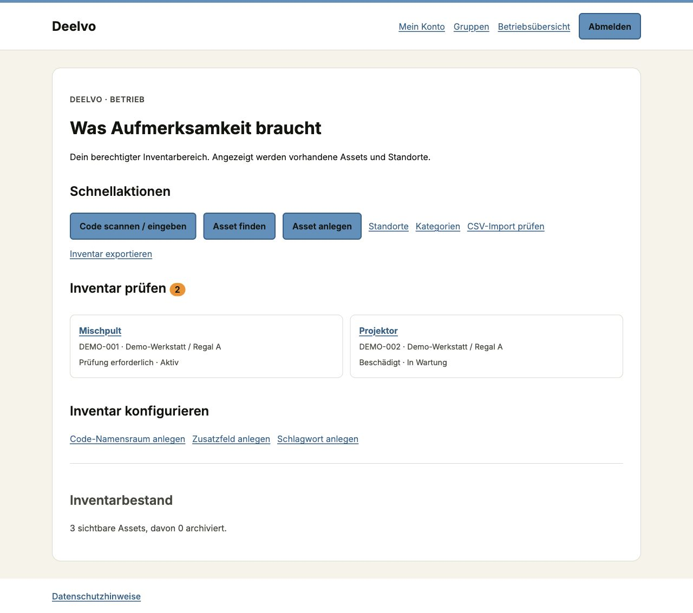

# Betriebsübersicht

Mit passenden Betriebsrechten erscheint „Betriebsübersicht“ in der Navigation. Die Ansicht zeigt ausschließlich deinen berechtigten Bereich. Ohne solche Rechte führt sie zu „Mein Konto“.

## Aufmerksamkeit zuerst

„Inventar prüfen“ listet sichtbare, nicht archivierte Assets mit Schaden, Prüfbedarf oder den Lebenszyklen nicht verfügbar, Wartung oder verloren. Öffne den Gegenstand, prüfe seinen Stand und führe nur die erforderliche berechtigte Änderung aus. Die Zahl bezieht sich auf den gesamten sichtbaren Prüfbestand; die Übersicht zeigt höchstens 20 Einträge. Weitere findest du mit Zustands-/Lebenszyklusfiltern im Inventar.

Inaktive sichtbare Standorte erscheinen separat. Sie können keine neuen Gegenstandszuordnungen erhalten, bis der betreffende Baum wieder passend aktiviert wurde. Alte Inventareinträge werden dadurch nicht gelöscht.

## Schnellaktionen

Je nach Rechten erscheinen Code nachschlagen, Asset finden/anlegen, Standorte, Kategorien sowie CSV-Import/-Export. Unter „Inventar konfigurieren“ findest du bei entsprechender Berechtigung Namensräume, Zusatzfelder und Schlagworte. Es gibt keine leeren Ausgabe-, Rücknahme- oder Buchungsschaltflächen.

Bestandszahlen stehen nach den Arbeitshinweisen. Die Übersicht enthält keine erfundenen Buchungen, Ausleihen, Wartungsaufträge oder Inventurläufe. Ein Lebenszyklus „Wartung“ ist ein vorhandener Assetstatus, noch kein geplanter Wartungstermin.

## Beispielansicht

Synthetische Daten, Phase 3 (15.10.2026): Hinweise und Schnellaktionen vor Bestandszahlen. Deine sichtbaren Einträge hängen von deinen Rechten ab.

## Buchungen und Heute — Phase 5

Mit booking.read_all zeigt „Heute“ reale bestätigte/aktive/abgeschlossene Buchungen, deren Zeitraum den heutigen lokalen Tag schneidet; stornierte werden ausgeblendet, höchstens 20 Zeilen. „Buchungen prüfen“ zählt offene Hinweise aus deinen aktuellen Lesescopes und führt zum [Buchungsbetrieb](booking-administration.md). Mit Konfigurations-/Sperrrechten ist dieser Betrieb auch ohne Inventarleserecht erreichbar; fremde Buchungsdetails werden dadurch nicht freigegeben. Es gibt weiterhin keine erfundenen Abhol-/Rückgabetermine.
