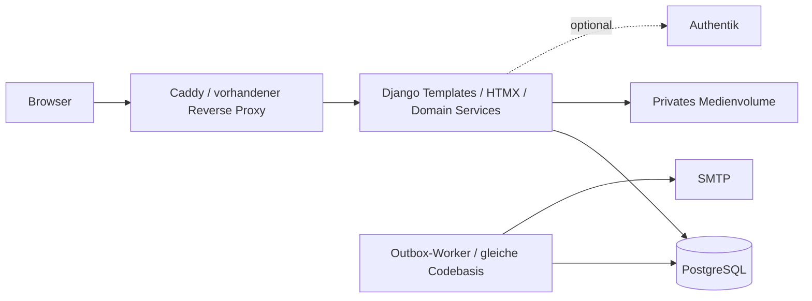

# Architektur — Phase 0 / vorgeschlagen

## Grenzen und Glossar

Ein modularer Django-Monolith, eine Organisation pro Installation, PostgreSQL als Wahrheitsquelle. Ein Asset ist ein physischer Gegenstand; eine Resource ein buchbares Angebot; eine Unit eine exklusiv belegbare Einheit; ein Booking ein Zeitversprechen; ein Loan tatsächlicher Gewahrsam. Qualification bezeichnet eine erteilte Einweisung, Group eine konfigurierbare Zugriffsgruppe. AgreementVersion ist ein unveränderlicher veröffentlichter Vertragstext, Acceptance die zugehörige Zustimmung. Diese Begriffe sind keine austauschbaren Statusfelder.

## Module und Abhängigkeiten

| Modul | Verantwortung | Liest / verwendet |
| --- | --- | --- |
| accounts | Identität, Profil, lokale Anmeldung, OIDC, Sperre | audit |
| access | Gruppen, Grants, Delegation, PolicyResolver | accounts, resources, qualifications |
| inventory | Assets, Orte, Zustand, Medien, Wartung | audit |
| resources | Angebote, Units, Pools, Bundles, Zeitpläne | inventory |
| agreements | Dokumente, Versionen, Zuordnung, Zustimmungen | accounts, inventory, resources |
| qualifications | unbefristete Einweisungen, Erteilung | accounts, resources |
| bookings | Verfügbarkeit, Reservierung, Serien, Claims | access, resources, agreements |
| loans | Ausgabe, Rücknahme, Gewahrsam | bookings, inventory, agreements, accounts |
| notifications | transaktionale Outbox, SMTP, Erinnerungen | unveränderliche Ereignispayloads |
| reporting | autorisierte Leseprojektionen, Exporte | Fachmodule |
| audit | minimale append-only Fachereignisse | stabile Referenzen, keine Rückrufe |

Komplexe Abläufe liegen in expliziten Domain-Services. Views, Formulare, APIs, Jobs und Admin-Aktionen rufen sie auf. Keine signalgesteuerte Buchungslogik. Ein Allocation-Service unter bookings kontrolliert sämtliche Claims, auch wenn loans die Ausgabe orchestriert. Er liest Gewahrsam über Claims, nicht durch Rückabhängigkeit auf loans. Keine zyklischen Modulimporte. Queries erhalten einen Autorisierungskontext; Reporting ist kein Berechtigungs-Bypass.

## Oberfläche und API

Serverseitige Django-Templates, HTMX für Teilaktualisierung, kleine lokale JS-Module. Formulare funktionieren grundsätzlich ohne JS. Tailwind wird nur beim Build benötigt. Keine SPA, kein CDN im Betrieb. Zunächst Wochenliste und Tagesansicht statt schwerem Kalenderpaket. DRF erst für begründet benötigte versionierte APIs, niemals zweite Fachlogik.

## Deployment-Entwurf, kein Deployment in Phase 0

Compose-Dienste: web, PostgreSQL, bei Benachrichtigungen ein Worker derselben Codebasis. Kein Redis im ersten Entwurf. PostgreSQL und Medien auf persistenten getrennten Volumes; Datenbank nicht öffentlich exponieren. Caddy terminiert TLS und erreicht nur web im privaten Netz. Static Assets lokal über Proxy; private Uploads ausschließlich nach Berechtigungsprüfung, ggf. interner Redirect. Vertrauenswürdige Proxyheader, erlaubte Hosts und CSRF-Ursprünge ausdrücklich konfigurieren.

Secrets per Umgebung/Secret-Dateien außerhalb Git. Container als nicht privilegierter Benutzer, Images nach Digest, begrenzte Ressourcen, Readiness mit DB-Test, Liveness ohne SMTP/OIDC. Ein einmaliger Releasejob führt Migrationen aus; kein konkurrierendes migrate beim Start aller Replikate. Hintergrundjobs benötigen DB-Leases, Retry-Limits und Sichtbarkeit fehlgeschlagener Zustellungen.

Planungsbudget für einen Pilot: 2 vCPU, 4 GiB RAM, SSD mit separat kalkuliertem Medien-/Backupbedarf; reine Ausgangshypothese, kein zugesicherter Mindestbedarf. Phase 1 misst Leerlauf/RSS; Phase 12 testet repräsentativen Katalog und parallele Buchungen. Workeranzahl erst nach Messung setzen.

## Konsistenz und Betrieb

DB-Commit erzeugt Booking/Claims/Audit/Outbox gemeinsam. E-Mailfehler ändern keine bestätigte Buchung. Keine Buchungsentscheidung aus Cache, Browser oder Suchindex. Exporte, iCal und Medien werden wie Detailansichten autorisiert. Strukturierte Logs mit Request-ID, ohne Passwörter, Kontaktdaten oder Vereinbarungstexte.

Backup: verschlüsselte externe Kopie von DB und Medien mit dokumentierter Konsistenzgrenze (Schreibpause oder koordinierter Snapshot). Restore isoliert durchführen, Mails deaktivieren, DB-FKs und Upload-Referenzen prüfen. RPO/RTO und Zielmedium müssen vor Produktion vom Betreiber festgelegt und gemessen werden.
