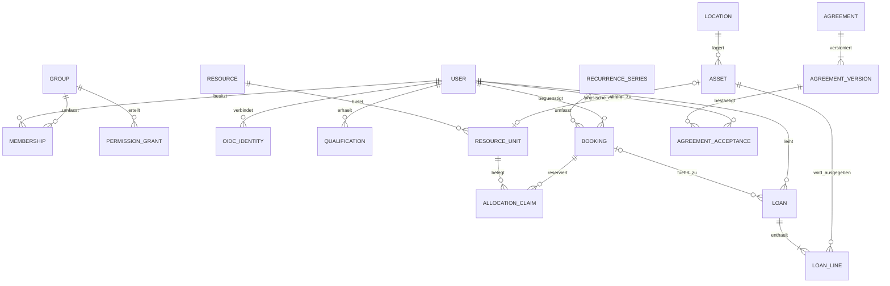

# Datenmodell — konzeptionell, keine Migrationen

Alle Fachobjekte besitzen stabile UUIDs, Erstellzeit und geeignete Änderungsrevision. Löschregeln sind ausdrücklich festzulegen; historische Ausleihen, Zustimmungen und Versionen werden nicht durch Cascade gelöscht.

## Entitäten und Integrität

| Entität | Zentrale Felder / Integritätsregeln |
| --- | --- |
| User / BorrowerProfile | normalisierte eindeutige E-Mail, verification_at, active, system_admin, employee_marker; Name, strukturierte Anschrift, Telefon; Profilrevision. Pflichtprofil für Ausleihe, kein unregistrierter BorrowerContact. |
| IdentityCheck | Benutzer, checked_at, checked_by, Methode Vor-Ort-Ausweisprüfung; keine Dokumentnummer, Kopie oder Geburtsdatum. Erste Ausgabe und Prüfung atomar. Korrekturen als Audit, nicht heimliches Überschreiben. |
| OIDCIdentity | eindeutiges Paar issuer+subject, User-FK; E-Mail ist kein Identitätsschlüssel. |
| Group / Membership / PermissionGrant | frei benannt; Aktion, genau ein scope (global/resource/category/location), optionale validierte Regeln; belegbare delegierte Obergrenze. Membership mit Historie. |
| QualificationType / UserQualification | Ressource/Kategorie, erteilende Person, Datum; im Pilot weder Ablauf noch Entzug. Falsche Erfassung nur privilegierte audierte Datenkorrektur, keine versteckte Entzugsfunktion. |
| Location / Asset | parent-FK ohne Zyklen; Asset mit eindeutiger Inventarnummer, optionaler Seriennummer, Zustand, Lebenszyklus und Ort. Kosten separat geschützt. |
| AssetRelation / AssetEvent | typisierte Kante, keine Selbstkante; part-of/Kit azyklisch. Bewegungen und Entsorgung historisch. |
| CustomFieldDefinition / Value | Typ, Sichtbarkeit, Validierung; eine typgerechte Value-Spalte pro Datentyp, unique asset+definition. Kein unvalidiertes JSON für Kerndaten. |
| Resource / ResourceUnit | Resource-Typ, Sichtbarkeit, Policy, location; Unit optional genau ein Asset. Physisches Asset höchstens eine aktive Unit, damit zwei Angebote nicht unabhängig dieselbe Sache versprechen. Raum-Unit logisch. |
| PoolMembership / BundleComponent | Pool hat Units; Bundle verweist auf Angebote/Pool mit Anzahl und required. Keine Zyklen; konkrete Asset-Kollisionen innerhalb eines Bundles deduplizieren oder als ungültige Konfiguration ablehnen. |
| Schedule / Exception | Zeitzone, Wochentag, lokale Zeitfenster, Zweck opening/pickup/return/usage; Ausnahmen mit Datum und Priorität. |
| BookingPolicy | Zeitmodus, Granularität, Dauer, Vorlauf, Horizont, Puffer, Nutzungslimits, Genehmigung; Revision und aufgelöster Snapshot. |
| Booking / Event | actor, beneficiary, Resource, Start/Ende, lokale Datumsfelder bei Tagesausleihe, Status, Revision, policy_snapshot; Ende nach Anfang. |
| AllocationClaim | Unit-FK, tstzrange, Kind reservation/hold/maintenance/custody, aktiv, genau ein Eigentümer; GiST-Exclusion auf unit und überlappende aktive Bereiche. Siehe BOOKING_ENGINE.md für Gewahrsam. |
| Loan / LoanLine | registrierter borrower, optionale Booking-FK, actor, expected_return; eine Line je physischem Asset, issue/return, Zustand, Zubehörstatus. Teilrückgabe möglich. |
| RecurrenceSeries | lokale Startzeit, TZ, erlaubte RRULE-Teilmenge, count/until, Status, Revision; Occurrence unique series+original_local_occurrence_key. |
| Agreement / AgreementVersion | Titel, Zweck, draft/published/retired; Version mit unveränderlichem Text, Versionsnummer, hash, published_at/by. Eindeutig document+version. |
| AgreementRequirement | globale Ausleihpflicht oder genau eine Resource/Asset-Zuordnung, Agreement-FK. Mehrere je Item; keine Zuordnung auf wechselbaren Freitext. |
| AgreementAcceptance | unique user+version, accepted_at, bestätigender User; keine stellvertretende Zustimmung durch Personal. |
| BookingAgreement / LoanAgreement | Nachweis der konkret zum Vorgang verlangten und akzeptierten Versionen, nicht nur Verweis auf aktuell neueste Version. |
| InsuranceDeclaration | User, Zeitpunkt, Erklärungstextversion, zugehörige Ausgabe; Selbstauskunft ohne Police oder Versicherernummer. |
| AuditEvent / Outbox / IdempotencyRecord | Actor, Aktion, Objekt-ID, minimaler diff, Request-ID; Outbox unique event+channel; Idempotenz unique actor+operation+key plus payload-hash und Ergebnis. |

Medien haben Owner, Dateityp, Größe, Sichtbarkeit und Scanstatus. Öffentliche Resource-Galerien sind ausdrücklich veröffentlichte Kopien/Referenzen, niemals automatisch die gesamte Asset-Dokumentation.

## Wiederverwendung, Historie und Datenschutz

Vereinbarungspflichten sind die deduplizierte Vereinigung aus globaler Ausleihe, Angebot, ausgewähltem Asset und allen ausgegebenen Bundle-Komponenten. Pools erfordern späteste Prüfung bei konkreter Zuweisung; technische Empfehlung ist konkrete Zuweisung schon bei Bestätigung. Anforderungen werden bei Ausgabe frisch aufgelöst.

Booking/Loan speichern nur die fachlich notwendige Profilrevision/Referenz; kein unbeschränkt vervielfältigtes Adressarchiv. Ob ein unveränderlicher Vertragsadresssnapshot notwendig ist, bleibt Privacy-Review. Geschlossene Vorgänge werden nach freigegebener Retentionsregel pseudonymisiert, offene Ausleihen nicht automatisch gelöscht. Audit enthält keine Ausweisdaten.

## Schema-Gates

Vor Migrationen: Claim-Constraints und Gewahrsamstrategie per PostgreSQL-Prototyp bestätigen; Grant-Algebra freigeben; Versionierungs-/Retentionsmodell prüfen. Indizes: active claims nach unit/range, bookings beneficiary/start/status, LoanLine offene Assets, memberships user, scoped grants, outbox next_attempt. Kein SQLite-Ersatz für Integritätstests.
