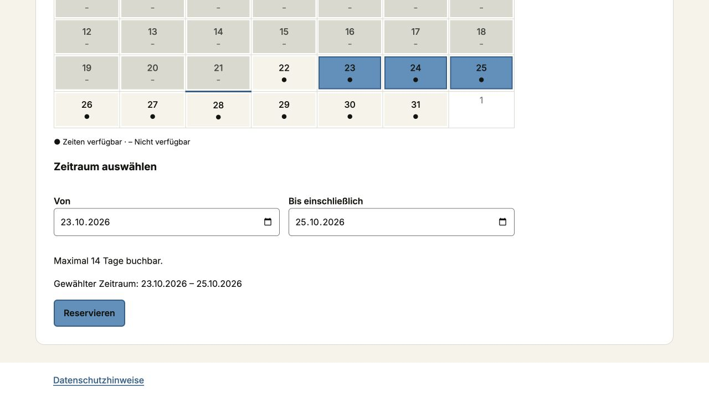
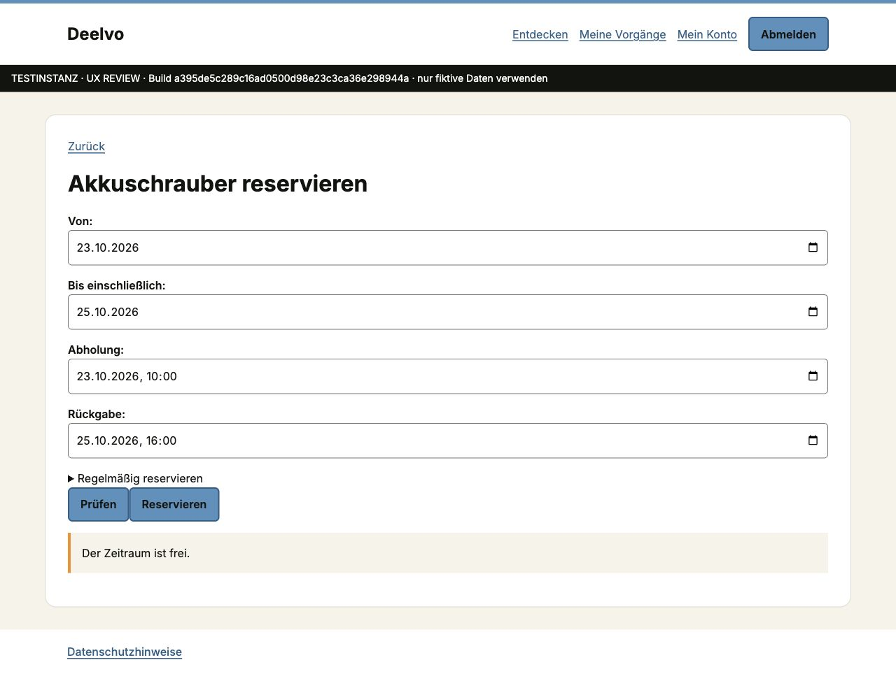

# Mehrtagesausleihe — 21.10.2026

Der Test-Akkuschrauber erlaubte fachlich 14 Tage, war aber als Zeitfenster-Ausleihe konfiguriert. Die bisherige Kalenderansicht bot das Ende ausschließlich am gewählten Starttag an.

Physische Ausleihen mit Zeitfenstern erhalten jetzt vollständige Datums- und Uhrzeitfelder für Beginn und Ende. Der gesamte Zeitraum wird serverseitig geprüft. Ganze Vielfache von 24 Stunden erscheinen als Tage. Vor-Ort-Angebote behalten ihre Uhrzeitansicht.

`correct_review_lending_dates` korrigiert ausschließlich vier unveränderte historische Test-Ausleihregeln auf Kalendertage. Der Befehl ist auf den Reviewbetrieb beschränkt, idempotent und verwendet den bestehenden auditierten Regeldienst. Bei zwischenzeitlich angepassten Regeln bricht er ab. Vorhandene Buchungen, Belegungen, Ausleihen und Benutzerpasswörter bleiben unverändert; es erfolgt keine neue Testdatenerzeugung.

Abnahme: Als normaler Nutzer den Akkuschrauber öffnen, einen Beginn und ein späteres Enddatum auswählen und den Zeitraum prüfen. Das Enddatum einer Tagesbuchung ist eingeschlossen. Abholung und Rückgabe bleiben getrennte Termine. Räume und Maschinen behalten ihre bisherigen Regeln und werden nicht als Mitnahme-Ausleihen modelliert.

Automatisierte Regression prüft insbesondere die dreitägige Reservierung bis zur Bestätigung, mehrtägige Zeitfenster-Ausleihen sowie die unveränderten Bestandsbuchungen und Benutzerkennwörter bei wiederholter Testdatenkorrektur.

Lokale Prüfung: 412 PostgreSQL-Tests bestanden (158,94 s); Ruff, Formatprüfung,
Mypy, Django-Systemprüfung, Migrationsprüfung und Dokumentprüfung bestanden.
Ergebnisdatei: [JUnit](../test-results/phase-13-lending-dates-local.xml).

Die Paketprüfung vom 21.10.2026 meldete neue Pillow-12.3.0-Advisories und
blockierte den ersten CI-Lauf. Die geprüften, hashgebundenen Pillow-13.0.0-Wheels
verwenden unveränderte Lizenztexte; die erneute OSV-/PyPI-Prüfung meldet für
alle 28 gesperrten Pakete null Befunde. Anschließend wurden sämtliche 412 lokalen
Tests mit Pillow 13.0.0 erneut ausgeführt. Die separate Vereinbarungspflicht
des Lastenrads bleibt bei der Korrektur erhalten.

## NCtest-Abnahme

Quellstand `a395de5c289c16ad0500d98e23c3ca36e298944a` läuft auf der isolierten
NCtest-Instanz. [Vollständige CI](https://github.com/IndieStu/Zirculeih/actions/runs/39576172355)
bestanden: 412 Tests, Modell-/Typ-/Formatprüfungen, Laufzeitrechte,
verschlüsseltes natives PostgreSQL-Backup mit separatem Restore und Lastprobe.
[CI-Nachweis](../test-results/phase-13-lending-dates-ci.json).
Die vorhandenen Container-Sicherheitsbefunde bleiben ein Produktions-/Releasegate;
dieser interne Fehlerfix hebt es nicht auf.

Vor dem Update wurde bei gestopptem Review-Web ein verschlüsseltes Backup von
Datenbank, Medien und lokaler Mailablage erzeugt. Der native Restore in eine
separate Prüf-Datenbank bestätigt: Alle 80 anderen Tabellen und sämtliche
vorherigen Audit-Einträge sind unverändert erhalten. Exakt vier Regeln wurden
auf Tagesausleihe geändert und auditiert; andere Regelfelder einschließlich der
Lastenrad-Vereinbarungspflicht blieben gleich. Medien/Mail sind hashgleich,
Zugangsdaten unverändert. Datenbankimage, Volumes und abgeschalteter alter
Review-Stack wurden nicht ersetzt. Das bisherige App-Image ist für Rollback
zusätzlich markiert; Konfiguration und Schlüssel werden getrennt vom Backup
geschützt aufbewahrt. [NCtest-Nachweis](../test-results/phase-13-lending-dates-nctest.json).
Beide verschlüsselten Sicherungsdateien wurden zusätzlich auf den lokalen Host
kopiert und dort erfolgreich authentifiziert entpackt; die Prüfkopien wurden
anschließend entfernt. Schlüssel und vorherige Konfiguration liegen separat
mit ausschließlich Eigentümerzugriff.

Browserprüfung mit normalem Testkonto: Akkuschrauber vom 23. bis einschließlich
25.10.2026 auswählen, Abholung am 23.10. um 10 Uhr und Rückgabe am 25.10. um
16 Uhr eingeben. „Prüfen“ meldet „Der Zeitraum ist frei.“ Es wurde dabei keine
Reservierung erzeugt. Beim 3D-Drucker bleiben Tageszeitband und Uhrzeitfelder
mit maximal acht Stunden erhalten.

Rollback: Nur den isolierten Review-Webdienst stoppen und das markierte bisherige
App-Image mit der geschützten vorherigen Konfiguration verwenden. Für eine exakte
Datenrückkehr das authentifizierte Backup nach dem bestehenden Wiederherstellungs-
Handbuch in eine neue Prüf-Datenbank/Volumes zurückspielen, vergleichen und erst
dann umschalten. Keinen Seed erneut ausführen und keine bestehenden Volumes löschen.
